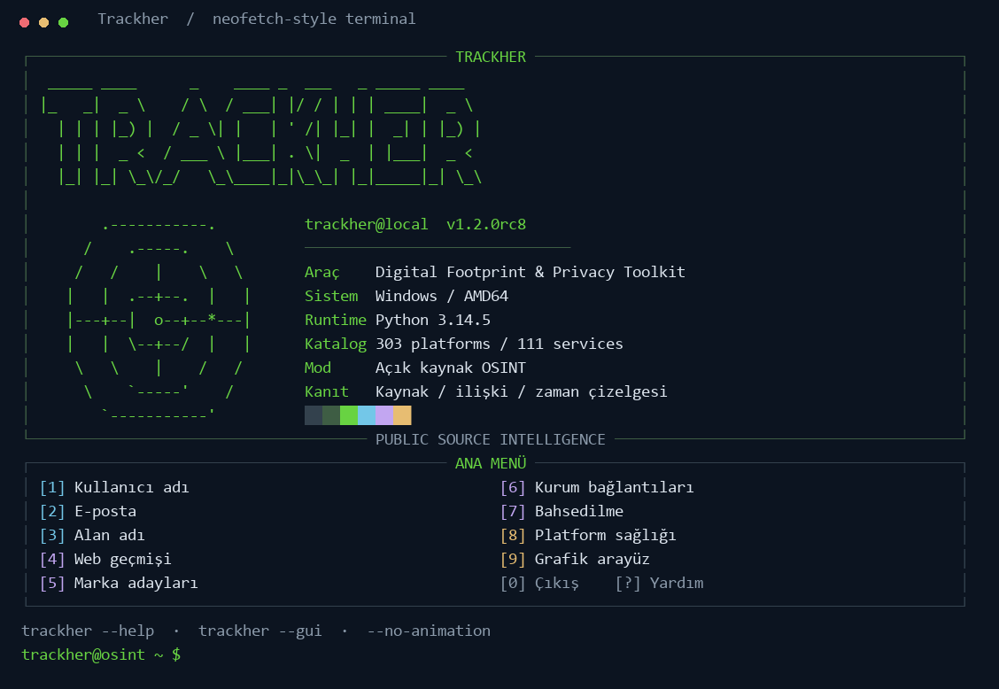
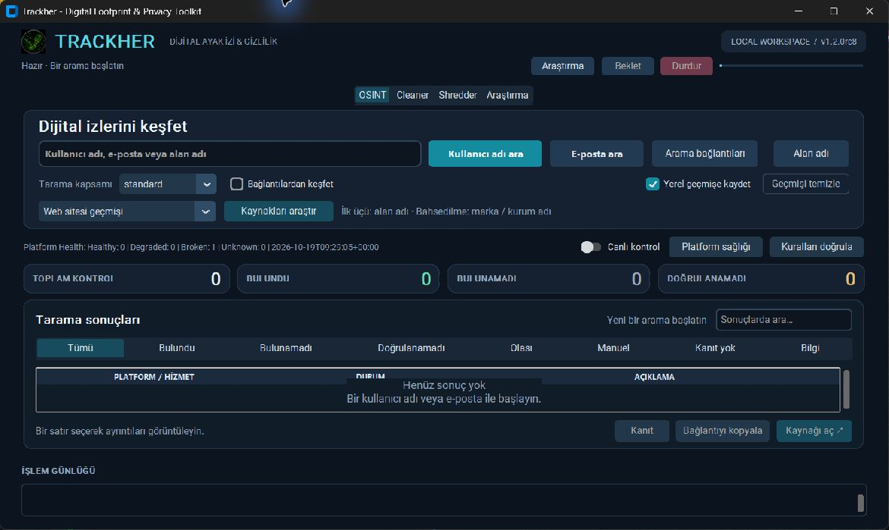
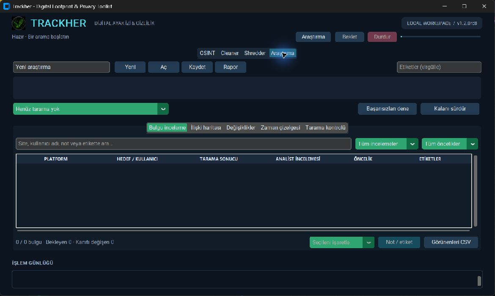

<p align="center">
  
</p>

# Trackher

Trackher is an open-source Python Digital Footprint & Privacy Toolkit for
reviewing parts of your own digital footprint and cleaning selected local
traces on your own devices. It ships with both a CLI and a GUI, and it is
designed around cautious, evidence-based checks instead of aggressive or
side-effectful probing.

> Trackher should only be used on accounts, usernames, and devices that belong
> to you, or for which you have explicit permission. See
> [ETHICS.md](ETHICS.md) for the usage policy.

## Why Trackher

- CLI + GUI
- Username OSINT across public profile patterns
- Email account intelligence with verified, possible, unknown, and manual separation
- Breach exposure checks through Have I Been Pwned
- Search engine dorks for manual investigation
- Public website history, passive brand research, organizational links, and news mentions
- Local investigation cases, evidence cards, analyst notes, and relationship maps
- Local cleanup tools for shell history, browser traces, and system caches
- Best-effort secure deletion for files and directories
- HTML and JSON reporting
- Risk scoring, scan history, remediation actions, identity correlation, and platform health
- Dry-run support before any destructive action
- Windows, macOS, and Linux support
- Scheduled cleanup support for Windows Task Scheduler, macOS `launchd`, and Linux `cron`

## CLI and GUI preview

### Terminal home

The interactive CLI opens with a neofetch-style radar, runtime information,
and a numbered menu. Run `trackher --menu`; use `--no-animation` for a static
entrance. Piped output remains noninteractive.



### OSINT workspace

The desktop interface groups search controls, live progress, status counters,
and filterable results. Select a result to inspect its evidence. Public-source
research is available from the selector beside **Kaynakları araştır**.



### Investigation workspace

The **Araştırma** tab keeps local cases, finding reviews, notes, relationship
maps, comparisons, timelines, and scan controls together.



GUI screenshots show the application before a scan; they contain no sample
findings. The CLI image renders the application's terminal menu.

## Safety Model

Trackher is intentionally conservative.

Cleanup refuses symlinks, junctions and other reparse points. Secure deletion
uses one verified regular-file handle for every overwrite pass, rather than
handing a mutable pathname to an external deletion utility. Shared hard-linked
files are refused. SSD/COW physical-erasure limitations still apply.

OSINT HTTP reads have a whole-request deadline and a 2 MiB response budget,
including redirect bodies. Requests ask for uncompressed data; unexpected
compressed responses are treated as unknown instead of decoded without a bound.

- Risky account checks that may trigger password resets, OTP messages, sign-in
  notices, or other side effects are skipped.
- Destructive actions require either `--dry-run`, interactive confirmation, or
  an explicit `--yes` flag.
- Critical system paths, user root paths, and protected exclusions are blocked
  from bulk deletion.
- HTML reports escape dynamic values and reject unsafe links.
- Local scan history and platform health state stay on the local machine.

## Features

### Terminal home

Run `trackher` or `trackher --menu` in an interactive terminal to open the
numbered Turkish menu. Its built-in neofetch-style layout places a radar emblem
beside system/runtime/catalog information, with a short scan/decode entrance.
It does not require the external neofetch command. Select 1–9, enter the target,
and return to the menu after the operation; use `?` for help and `0` to exit.
Existing CLI flags and cleanup commands remain available through `--help`.

Use `--no-animation` or `TRACKHER_NO_ANIMATION=1` for a static entrance;
`--no-color` / `NO_COLOR` suppress colors and the entrance animation.
Redirected output, noninteractive stdin and dumb terminals never animate or
wait for menu input. `--version`, `--help` and GUI startup do not play the boot.

Details: [TERMINAL_HOME_2026-10-17.md](TERMINAL_HOME_2026-10-17.md).

### OSINT

- Username scan across 303 platforms
- Email OSINT with a catalog of 111 services
- Only a small side-effect-free subset is automatically checkable today
- Automatic email checks currently include Gravatar, GitLab, and GitHub
- Search engine dork generation for manual investigation

Username results require site-specific profile or API evidence. A username
echoed by a search page, a generic HTTP 200 response, or a single page marker
does not confirm an account. Older HTML checks without enough evidence remain
`UNKNOWN`; a catalog entry does not guarantee automatic verification.

Email results are separated as:

- `FOUND`: verified passive evidence
- `NOT_FOUND`: reliably checked and absent
- `POSSIBLE`: heuristic evidence only
- `UNKNOWN`: inconclusive or error
- `MANUAL`: no safe automatic check is available

`Have I Been Pwned` is kept separate under `Breaches` and uses `HIBP_API_KEY`
when configured.

### Scan Profiles

Use `--profile` to choose how broad a scan should be.

- `quick`: verified and high-confidence checks only
- `standard`: current default behavior
- `deep`: currently matches `standard`; reserved for broader coverage
- `username-only`: run username OSINT only
- `email-only`: run email OSINT only

### Scan History + Diff

Trackher stores normalized local snapshots and compares each scan against the
previous matching scan.

- Use `--no-history` to disable storage and diffing for a run
- Use `--clear-history` to remove local history data
- If two scans use different profiles, Trackher warns that diff coverage differs

### Identity Correlation

Trackher can group public findings that may belong to the same digital identity.
This is probabilistic, not certain, and it is based only on public signals such
as the same username, display name, avatar hash, linked website/domain, or
matching public profile metadata.

### Risk Score

Trackher includes an explainable Digital Footprint Risk Score from `0` to `100`.

- Levels: `LOW`, `MEDIUM`, `HIGH`, `CRITICAL`
- The score is based only on scan evidence
- Verified findings contribute more than heuristic or unreliable findings
- `MANUAL`, `UNKNOWN`, and `ERROR` do not increase the score
- Breaches contribute to risk
- Category caps prevent one finding type from dominating
- The score is not a scientific measurement or a security guarantee

### Platform / Detector Health

Trackher can check platform and detector health separately from normal scans.

- `--health-check` runs offline schema and catalog validation
- `--health-check-live` adds optional safe live probes where supported
- Health data is cached locally and does not affect normal scan behavior

### Remediation / Privacy Actions

When Trackher finds an exposure, it can show official user-facing links for
privacy settings, account security, data export, deletion help, or profile
pages. It never automates those actions.

### Cleanup

- Shell and terminal history cleanup
- Browser cache and selected browser trace cleanup
- Cross-platform system temp and cache cleanup
- Exclusion list support through JSON config

### Secure Deletion

- Best-effort overwrite and delete for files
- Recursive directory shredding
- Symlink and critical-path protections
- Secure deletion is still best-effort on SSD, copy-on-write, journaled, or
  network-backed file systems

## Public evidence and linked discovery

Verified username checks now retain public metadata where the response exposes it:
profile name, description, avatar URL, website, declared links and supported API
fields. Each result includes an evidence card with its time, source, detector,
matching rules and field provenance. Cards are available in the GUI and HTML/JSON
reports; email candidates, manual checks and inconclusive results remain distinct.

Enable **Bağlantılardan keşfet** in the GUI, or use:

```powershell
trackher --username YOUR_USERNAME --discover-linked --report html
```

Linked discovery checks only profile URLs matching the selected platform catalog,
from verified seed profiles. It follows one hop, deduplicates candidates, caps the
work at ten additional checks, and uses a 35-second total discovery budget.
Arbitrary personal websites are listed as evidence rather than fetched. The
feature is off by default; enabling it does not make ownership claims.

**Alan adı** in the GUI accepts a domain (or takes the domain from an email).
The CLI equivalent is:

```powershell
trackher --domain example.com --report json
```

Domain research retrieves A, AAAA, MX and NS records plus authoritative HTTPS RDAP
data selected using IANA's bootstrap registry. It reports registration events,
registrar handles and nameservers when available. Missing or blocked sources stay
inconclusive; this does not verify a mailbox or identify a real-world owner.

Use **Kuralları doğrula** or this command to check configured positive/negative
reference pairs and see the last successful validation:

```powershell
trackher --validate-sites --report html
```

Recent checks are cached for 24 hours; a later failure preserves the earlier
success timestamp while showing the current failure. This runs when requested;
it does not install an unattended scheduled task. Existing scan history and
identity correlation also remain available. Reciprocal declared profile links
add explainable signals; shared usernames alone do not establish identity.

## Research workspace and scan controls

The **Araştırma** tab keeps multiple scans in a portable `.trackher.json` case
file, with notes, tags, analyst relationship decisions and an HTML export.
Choose **Kaydet** to store the file locally and **Aç** to reopen it later.
Case files contain the collected public evidence and your notes; they are not
uploaded. Scans are added to the open case in memory regardless of the separate
local-history checkbox. Save the case before closing the application.

Use **Beklet** to stop scheduling new checks while current checks finish,
**Devam et** to release waiting checks, and **Durdur** to cancel pending work.
The **Tarama kontrolü** view shows elapsed time, pending/running jobs and failure
reasons. Interrupted checks remain inconclusive. After stopping, save the case;
**Kalanı sürdür** can resume its interrupted username/email checks after reopening.
**Başarısızları dene** retries unknown/error/unconfigured checks. Other results
retain their original evidence timestamps and are marked as retained, rather
than appearing freshly checked. Interrupted scans and subset retries do not enter
legacy risk history; their evidence remains in the open research case.

The **İlişki haritası** view includes query identifiers, profile candidates and
declared website domains. Select a focus node to inspect its neighbors; click a
node for source evidence or a line for supporting signals and conflicts. Mark
relationships as related, unrelated or uncertain. These are analyst notes and
never change account detection status or establish real-world ownership. The
graph processes the first 200 profiles and displays up to 24 neighbors per focus;
the source result list and case file keep all results.

**Değişiklikler** compares matching targets, including biography edits, removed
or added links, status changes and temporarily unavailable profiles. Missing
coverage or a field no longer extracted is shown separately from deletion.

Domain research now also checks SPF/DMARC policy records and resolver DNSSEC
authentication. These are bounded record checks, not a complete SPF evaluator.
The GUI additionally queries certificate logs for up to 200 deduplicated subdomain
candidates without visiting them; the CLI enables this with:

```powershell
trackher --domain example.com --passive-subdomains --report html
```

Certificates can be historical; a candidate does not establish a currently live
host or service. Source failures stay unknown. HIBP email checks now request full
breach metadata (dates, data classes and verification flags) when `HIBP_API_KEY`
is configured. No password or raw credential contents are collected. Protocol
references: [Google DNS JSON](https://developers.google.com/speed/public-dns/docs/doh/json),
[HIBP full breach response](https://haveibeenpwned.com/API/v3#AllBreachesForAnAccount).

## Finding review queue

Open **Araştırma → Bulgu inceleme** to search each scan's findings by site,
handle, analyst notes or tags. Filter by review state and priority, or select
multiple rows to mark them together. Double-click a row to edit its note, tags,
priority and analyst state: pending, reviewed, irrelevant or uncertain.

Analyst annotations never change the machine's detection result. Notes follow
the same target/platform/handle across rescans. If source evidence, detector rules
or public fields differ from the annotated version, the finding appears under
**Kanıt değişti**; the earlier note and decision remain available. A new check
timestamp alone does not invalidate a review. Search supports Turkish dotted and
dotless I and unaccented input.

Use **Görünenleri CSV** to export the currently filtered queue. CSV cells that
could be interpreted as spreadsheet formulas are escaped. The case HTML report
also includes analyst notes, tags, priority and evidence-change indicators.

Apply a note with **Uygula**, then use the case's **Kaydet** button to persist it.
Existing version-1 case files remain compatible. When opening another case or
closing the app with unsaved changes, Trackher offers save/discard/cancel. Saving
on exit during a scan first stops the scan and waits for its results before
writing the case. No automatic background upload or autosave is enabled.

## Requirements

- Python 3.10 or newer
- Internet connection for OSINT features
- Tk support for the GUI

If Tk is missing on Debian or Ubuntu:

```bash
sudo apt install python3-tk
```

## Dependencies

Main runtime dependencies: `rich`, `httpx`, `customtkinter`, `Pillow`

## Installation

### Developer source run

Windows PowerShell:

```powershell
py -3 -m venv .venv
.\.venv\Scripts\Activate.ps1
python -m pip install --upgrade pip
python -m pip install -r requirements.txt
python main.py
```

macOS / Linux:

```bash
python3 -m venv .venv
source .venv/bin/activate
python -m pip install --upgrade pip
python -m pip install -r requirements.txt
python main.py
```

Running `python main.py` with no arguments launches the GUI if GUI
dependencies are available. Passing arguments runs the CLI mode.

### Installed CLI

```bash
python -m pip install .
trackher --version
trackher --username example_user
```

### Windows packaged build

The packaging workflow produces a standalone Windows bundle that launches the
GUI on double-click and also supports CLI arguments:

```powershell
.\Trackher.exe
.\Trackher.exe --username example_user
```

## Quick Start

### Email checks

```bash
python main.py --email analyst@example.com
```

```text
Email Account Discovery

Verified Accounts
✓ Gravatar

Possible Accounts
~ GitHub - Public profile email matched exactly (exampleuser)

Breaches
! Have I Been Pwned: NOT CONFIGURED

Manual Investigation
Most remaining services require manual review.
Use --show-manual to display them.
```

```bash
python main.py --email analyst@example.com --show-manual --search-dork
```

```text
Email Account Discovery

Verified Accounts
✓ Gravatar

Possible Accounts
~ GitHub - Public profile email matched exactly (exampleuser)

Manual Investigation
> Figma
> Notion
> Trello
...

Breaches
! Have I Been Pwned: NOT CONFIGURED
```

### Username checks

```bash
python main.py --username example_user --search-dork
```

```text
[INFO] Taraniyor: example_user
[+] Found on 3/197 platforms: Reddit, GitLab, Medium
[?] 4 platform checks could not be verified
[INFO] Google, Bing, DuckDuckGo, and Yandex dorks generated
```

```bash
python main.py --username example_user
```

```text
[INFO] Taraniyor: example_user
[+] Found on 2/197 platforms: Reddit, Medium
[?] 3 platform checks could not be verified
```

### Cleanup preview and execution

```bash
python main.py --clean-all --dry-run
python main.py --clean-all --yes
python main.py --clean-browser --clean-system --dry-run
```

### Exclusions

```bash
python main.py --clean-all --dry-run --exclude exclusions.example.json
```

### Secure deletion

```bash
python main.py --shred /path/to/file --dry-run
python main.py --shred /path/to/file --yes
```

### Scheduled cleanup

```bash
python main.py --schedule weekly --dry-run
python main.py --schedule weekly --yes
```

## Reports

Trackher can generate reports in HTML or JSON:

```bash
python main.py --email analyst@example.com --report html
python main.py --email analyst@example.com --report json
python main.py --username example_user --report html
python main.py --username example_user --report json
```

Generated report filenames follow this pattern:

- `trackher_report_html.html`
- `trackher_report_json.json`

These files are already ignored by `.gitignore`.

Reported vulnerabilities are handled through the disclosure process described in
[SECURITY.md](SECURITY.md).

## HIBP API Key

Have I Been Pwned support is optional. Without `HIBP_API_KEY`, Trackher keeps
running and reports `NOT CONFIGURED` for that provider.

PowerShell:

```powershell
$env:HIBP_API_KEY = "<key>"
```

macOS / Linux:

```bash
export HIBP_API_KEY="<key>"
```

## Common Flags

- `--show-manual`: reveal manual email services in the console output
- `--no-history`: skip local scan history storage and diffing
- `--clear-history`: remove local scan history
- `--health-check`: run offline catalog and schema health checks
- `--health-check-live`: add safe live health probes where supported
- `--profile quick|standard|deep|username-only|email-only`: choose scan breadth

## Platform Support

| Feature | Windows | macOS | Linux |
|---|:---:|:---:|:---:|
| GUI | Yes | Yes | Yes |
| CLI | Yes | Yes | Yes |
| OSINT | Yes | Yes | Yes |
| Cleanup | Yes | Yes | Yes |
| Scheduling | Yes | Yes | Yes |
| Context menu helper | Yes | No | Limited |

## Testing

```bash
python -m pip check
python -m compileall -q footprint osint utils gui main.py setup_context_menu.py
python -m unittest discover -s tests -v
```

The project includes automated tests for:

- Cross-platform cleanup path selection
- Safe deletion and exclusion handling
- HTML report escaping
- Non-interactive destructive action protection
- Username detection rules
- Email status grouping and HIBP configuration handling
- GUI queue and terminal memory behavior

## Repository Guide

- [CONTRIBUTING.md](CONTRIBUTING.md): contribution workflow
- [SECURITY.md](SECURITY.md): security disclosure policy
- [ETHICS.md](ETHICS.md): acceptable use policy
- [CHANGELOG.md](CHANGELOG.md): release history
- [CODE_OF_CONDUCT.md](CODE_OF_CONDUCT.md): community expectations

## Public-source research workspace

The OSINT tab now includes a research selector beside **Kaynakları araştır**.
Enter a domain such as `python.org` for website history, brand candidates, or
organizational footprint; enter a brand/organization name for public mentions.
Results use the existing source cards, finding notes, case files, relationship
map, comparisons, and **Araştırma → Zaman çizelgesi** view.

```powershell
python main.py --web-history python.org --report html
python main.py --brand-research python.org --report json
python main.py --organization python.org
python main.py --mentions "Python Software Foundation" --report html
```

- History: up to 30 Wayback CDX records and up to two sampled captures of the
  same page, with titles, public links and text/link differences when accessible.
  Samples do not represent the full history or necessarily the latest capture.
- Brand: up to 30 passive certificate names containing the brand label/token.
  These are **unverified candidates**, not confirmed impersonators; this is not
  exhaustive typo/homoglyph detection. Candidate sites are not visited.
- Organization: at most 30 public outgoing homepage references, including
  catalog profile links. HTTPS root/www redirects are bounded and validated.
  References do not establish ownership, subsidiaries or endorsement.
- Mentions: up to 30 Google News RSS records, with duplicate grouping and
  unverified relevance. This public feed does not cover all blogs,
  forums or news sources. Articles are not crawled.

Each operation has a finite deadline and download limits. Provider blocks,
timeouts and invalid responses remain **unknown**, never evidence of absence.
Timeline entries distinguish publication/archive/certificate dates from the
time Trackher collected them. No API key or new dependency is required.

Implementation and live-test limits: [OSINT_MODULES_2026-10-17.md](OSINT_MODULES_2026-10-17.md).
Follow-up fixes and rechecks: [OSINT_REVIEW_2026-10-17.md](OSINT_REVIEW_2026-10-17.md).
Additional 30-site investigation: [REMAINING_SITES_2026-10-17.md](REMAINING_SITES_2026-10-17.md).

Next 30-site investigation and public channel verification: [REMAINING_SITES_2026-10-19.md](REMAINING_SITES_2026-10-19.md).

Reflected usernames and generic page markers no longer confirm accounts; see [FALSE_POSITIVE_GUARD_2026-10-19.md](FALSE_POSITIVE_GUARD_2026-10-19.md) for live checks and coverage limits.

## Limitations

- Secure deletion is best-effort and cannot guarantee physical overwrite on SSD,
  copy-on-write, journaled, compressed, or network-backed file systems.
- OSINT results can change as services update their behavior, anti-bot rules,
  or public endpoints.
- Identity correlation is probabilistic and should not be treated as proof of
  identity or account ownership.
- Risk scores are explainable heuristics, not scientific or security guarantees.

## License

This project is released under the MIT License. See [LICENSE](LICENSE).
